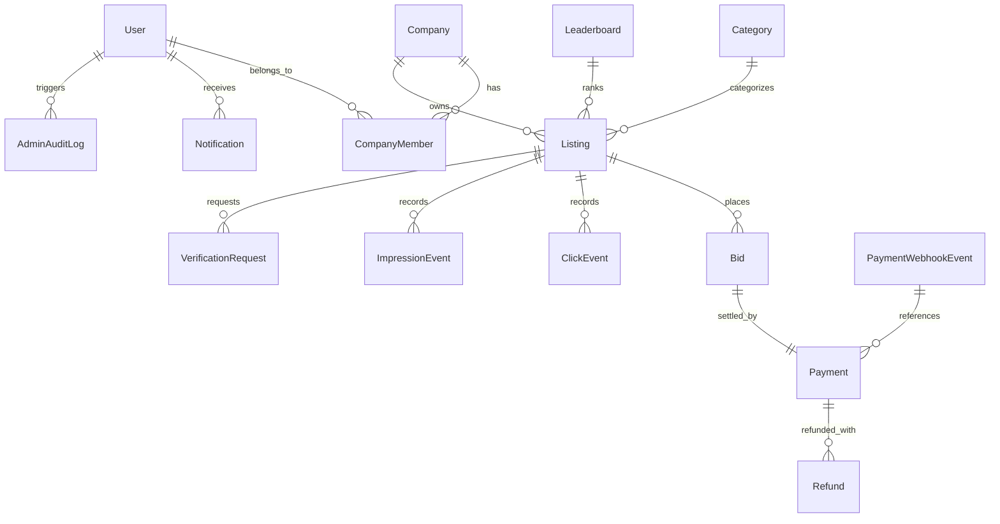
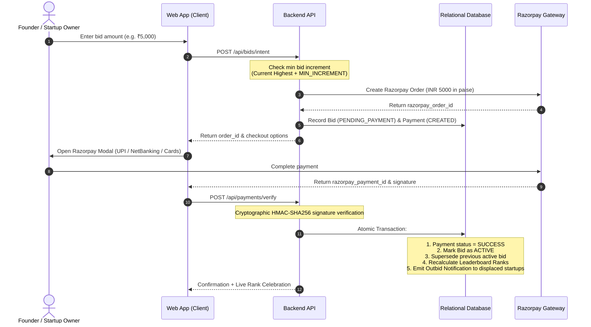

# StartupBaazi (स्टार्टअप बाज़ी) 🚀
### India's Paid Startup Visibility & Leaderboard Platform

[](https://www.typescriptlang.org/)
[](https://reactjs.org/)
[](https://vitejs.dev/)
[](https://tailwindcss.com/)
[](https://expressjs.com/)
[](https://www.prisma.io/)
[](https://razorpay.com/)

**StartupBaazi** is a modern, production-grade visibility and leaderboard platform inspired by the pay-to-rank concept of *Outbid.lol*, customized specifically for the Indian startup ecosystem. Indian startups, SaaS products, agencies, and D2C brands can submit their venture, gain verified public recognition, and compete for top leaderboard rankings through transparent bidding in Indian Rupees (₹).

---

## 🌟 Key Features

1. **Live Indian Startup Leaderboard**
   - Real-time ranking calculated strictly by verified active promotional bids in INR (₹).
   - Gold 🥇, Silver 🥈, Bronze 🥉 badges for Top 3; verified company checkmarks.
   - Comprehensive filtering by Indian startup hubs: **Bengaluru, Delhi NCR, Mumbai, Pune, Hyderabad, Chennai, Indore**, etc.
   - Industry filters: **AI & Indic Tech, SaaS & Enterprise, Fintech & Payments, Developer Tools, D2C, EdTech, Healthcare, Logistics**.
   - Outbound official website links with cryptographic privacy-preserving click & impression tracking.

2. **Server-Controlled Bidding Engine**
   - Atomic database transactions prevent race conditions during concurrent bids.
   - Dynamic next minimum bid calculation (`current_top_bid + min_increment`).
   - Configurable starting minimum prices and bid increments.
   - Immediate rank recalculation upon payment confirmation.
   - Automated in-app outbid notifications alerting founders when their position is challenged.

3. **Indian Payment Gateway Integration (Razorpay)**
   - Razorpay orders created securely on backend in paise (₹1 = 100 paise).
   - Server-side cryptographic HMAC-SHA256 signature verification (`crypto.timingSafeEqual`).
   - Idempotent webhook receiver (`payment.captured`, `order.paid`) with duplicate event prevention.
   - Zero storage of raw card or bank credentials.
   - Seamless test mode & simulator for local development without live merchant credentials.

4. **Multi-Step Startup Listing Submission**
   - 4-step wizard: Startup Profile → Location & Industry → Socials & GitHub → Guidelines Agreement.
   - Mandatory administrative review workflow (`PENDING_APPROVAL`, `APPROVED`, `REJECTED`, `SUSPENDED`).
   - Full validation using **Zod** on both client and server.

5. **Founder Analytics & Dashboard**
   - 7-day traffic trends visualized with **Recharts** (impressions vs outbound clicks).
   - Real CTR (Click-Through Rate) computation.
   - In-app notification center with one-click re-bidding.
   - Financial ledger with Razorpay order IDs and payment receipts.
   - Startup profile editor.

6. **Mission Control Admin Dashboard**
   - Protected with role-based access control (`ADMIN` vs `FOUNDER` vs `USER`).
   - 1-click Approve, Reject (with custom reason), and Suspend actions.
   - Verification badge toggle.
   - Configurable leaderboard bidding parameters (minimum starting bid & minimum increment).
   - Complete financial ledger and immutable administrative audit logs.

7. **Legal, Trust & Compliance**
   - Transparent disclaimer: rankings are based strictly on paid promotional bidding rules, not equity or investment quality assessments.
   - Comprehensive Terms of Service, Privacy Policy, Refund Policy, and Bidding Engine Rules.

---

## 🛠️ Technology Stack

| Layer | Technologies |
|---|---|
| **Frontend** | React 18, TypeScript, Vite, Tailwind CSS, React Router DOM v6, Lucide Icons, Recharts |
| **Backend** | Node.js, Express.js, TypeScript, Zod, JWT (`jsonwebtoken`), bcryptjs, Helmet, Morgan, CORS |
| **Database & ORM** | Prisma ORM, SQLite (`dev.db` for zero-config local run) & PostgreSQL schema (`schema.postgresql.prisma` for production) |
| **Payments** | Razorpay Node.js SDK (UPI, Cards, NetBanking, HMAC-SHA256 verification) |
| **Testing** | Vitest, Supertest (16 automated tests covering Auth, Submission, Bidding, Payments, Ranking, Moderation) |

---

## 🗄️ Database Architecture (16 Normalized Models)



1. **User**: Authentication, roles (`ADMIN`, `FOUNDER`, `USER`), verification status.
2. **Company**: Legal details, HQ city/state, founded year, funding stage, social links.
3. **CompanyMember**: Role mappings (OWNER, ADMIN, MEMBER).
4. **Category**: Industry groupings (Fintech, SaaS, AI, D2C, Developer Tools, etc.).
5. **Listing**: Approval lifecycle (`PENDING_APPROVAL`, `APPROVED`, `REJECTED`, `SUSPENDED`), current rank, view/click counters.
6. **Leaderboard**: Bidding configurations (`minBidAmount`, `minBidIncrement`).
7. **Bid**: Server-controlled bid bids (`PENDING_PAYMENT`, `ACTIVE`, `OUTBID`, `EXPIRED`).
8. **Payment**: Razorpay order tracking, amounts in INR, status (`CREATED`, `SUCCESS`, `FAILED`).
9. **PaymentWebhookEvent**: Idempotent webhook tracking with raw payload hash.
10. **Campaign**: Time-bound paid spotlight campaigns.
11. **ClickEvent**: Outbound website click tracking with anonymized IP hash.
12. **ImpressionEvent**: View tracking.
13. **Notification**: In-app outbid alerts, approvals, and receipts.
14. **VerificationRequest**: Business verification tracking.
15. **AdminAuditLog**: Immutable trace of all admin actions.
16. **Refund**: Tracking of refund requests.

---

## 🚀 Quick Start (Local Setup)

### Prerequisites
- Node.js >= 18 (Tested on Node.js v26)
- npm >= 9

### 1. Clone & Install Dependencies
```bash
git clone https://github.com/your-username/startupbaazi.git
cd startupbaazi

# Install server dependencies
cd server
npm install

# Install client dependencies
cd ../client
npm install
```

### 2. Configure Environment Variables
Copy `.env.example` in `server/`:
```bash
cd ../server
cp .env.example .env
```
Default `.env` configuration:
```env
PORT=5000
NODE_ENV=development
CLIENT_URL=http://localhost:3000
DATABASE_URL="file:./dev.db"
JWT_SECRET=startupbaazi_super_secure_jwt_dev_key_2026_xyz
JWT_EXPIRES_IN=7d
RAZORPAY_KEY_ID=rzp_test_placeholder_key_id
RAZORPAY_KEY_SECRET=placeholder_secret
RAZORPAY_WEBHOOK_SECRET=placeholder_webhook_secret
DEFAULT_MIN_BID_AMOUNT=500
DEFAULT_MIN_BID_INCREMENT=100
```

### 3. Initialize Database & Seed Real Indian Startups
```bash
# Push Prisma schema to SQLite
npx prisma db push

# Seed realistic startups (Zerodha, Postman, Zoho, Razorpay, Krutrim, Hasura, etc.)
npm run prisma:seed
```

### 4. Run Automated Tests
```bash
npm test
```
*Expected: 16 passing tests covering Health, Leaderboards, Auth, Listing Submissions, Admin Moderation, Bidding Rules, Payment Signature Verification, and Outbound Click Tracking.*

### 5. Start Development Servers
From the root directory:
```bash
# Start backend server (port 5000)
npm run dev:server

# In another terminal, start client (port 3000)
npm run dev:client
```
Visit **http://localhost:3000** in your browser.

---

## 🧑‍💻 Pre-Seeded Test Accounts

| Role | Email | Password | Access Capabilities |
|---|---|---|---|
| **Admin** | `admin@startupbaazi.in` | `Admin@12345` | Moderation desk, approve/reject startups, edit bidding rules, view platform revenue & audit logs |
| **Founder** | `founder@startupbaazi.demo` | `Founder@12345` | Founder workspace, Zerodha listing, outbid competition, view traffic analytics |

*Tip: The Sign In page features convenient 1-click demo login buttons.*

---

## 💳 Razorpay Payment & Webhook Architecture



### Test Mode vs Production
- **Local Dev / Test Mode**: If `RAZORPAY_KEY_ID` contains `placeholder` or test credentials, the system automatically enables a simulated test payment button, allowing developers to test the complete end-to-end flow without requiring live merchant credentials.
- **Production Mode**: Supply live Razorpay API keys (`rzp_live_...`). Real UPI, Google Pay, PhonePe, Paytm, credit/debit cards, and NetBanking will be rendered in the Razorpay checkout overlay.

---

## 📡 API Reference

### Authentication
- `POST /api/auth/register` — Register founder account
- `POST /api/auth/login` — Sign in and obtain JWT
- `GET /api/auth/me` — Authenticated user profile and company memberships

### Companies & Listings
- `POST /api/companies` — Submit startup for admin review (`PENDING_APPROVAL`)
- `GET /api/companies/:slug` — Public SEO profile (Approved startups)
- `PUT /api/companies/:id` — Update startup details (Owner/Admin)
- `POST /api/companies/:id/click` — Track outbound website click
- `GET /api/companies/my-companies` — Get startups owned by authenticated user

### Leaderboards
- `GET /api/leaderboards` — List active leaderboards
- `GET /api/leaderboards/:slug` — Paginated leaderboard with filters (`industry`, `city`, `search`, `sort`, `page`, `limit`)
- `GET /api/leaderboards/:slug/requirements` — Fetch minimum bid required for Rank #1 or target rank

### Bidding & Payments
- `POST /api/bids/intent` — Create bid intent and Razorpay payment order
- `GET /api/bids/history/:listingId` — Audit history of bids placed for a startup
- `POST /api/payments/verify` — Verify Razorpay signature, activate bid, update ranking atomically
- `POST /api/payments/webhook` — Idempotent webhook receiver for Razorpay events
- `GET /api/payments/my-history` — User's transaction ledger

### Analytics & Notifications
- `GET /api/analytics/dashboard` — Founder dashboard traffic metrics, CTR, and 7-day trend
- `GET /api/analytics/notifications` — In-app alerts (outbids, approvals, payments)
- `PATCH /api/analytics/notifications/:id/read` — Mark notification as read
- `PATCH /api/analytics/notifications/read-all` — Mark all notifications read

### Administration (Requires `role: 'ADMIN'`)
- `GET /api/admin/stats` — Platform revenue, pending count, active bids, user totals
- `GET /api/admin/listings` — List all submissions filtered by status
- `PATCH /api/admin/listings/:id/status` — Approve, Reject (with reason), or Suspend
- `PATCH /api/admin/listings/:id/verify` — Toggle verified badge
- `GET /api/admin/payments` — Global financial transactions ledger
- `GET /api/admin/audit-logs` — Administrative audit history
- `PATCH /api/admin/leaderboard-rules` — Configure base price & minimum bid increment

---

## 🌐 Production Deployment Guide

### Frontend (Vercel)
1. Link repository to Vercel.
2. Root Directory: `client`.
3. Build Command: `npm run build`.
4. Output Directory: `dist`.
5. Environment Variables:
   - `VITE_API_URL`: Your backend API URL (e.g. `https://api.startupbaazi.in`).

### Backend (Render / Railway / Fly.io)
1. Deploy `server/` directory as a Node.js web service.
2. Build Command: `npm install && npm run build && npx prisma generate`.
3. Start Command: `npm start`.
4. Environment Variables:
   - `PORT`: `5000`
   - `NODE_ENV`: `production`
   - `DATABASE_URL`: PostgreSQL connection string (from Supabase, Neon, or Render PostgreSQL).
   - `JWT_SECRET`: Random 32+ character secure secret.
   - `RAZORPAY_KEY_ID`: `rzp_live_...`
   - `RAZORPAY_KEY_SECRET`: Razorpay Secret Key.
   - `RAZORPAY_WEBHOOK_SECRET`: Webhook Secret configured in Razorpay Dashboard.
   - `CLIENT_URL`: `https://startupbaazi.in`

### Production PostgreSQL Schema
A dedicated PostgreSQL schema is included at `server/prisma/schema.postgresql.prisma`. To switch to PostgreSQL:
```bash
# In server/prisma/schema.prisma, change provider to postgresql:
datasource db {
  provider = "postgresql"
  url      = env("DATABASE_URL")
}
```
Then run:
```bash
npx prisma migrate deploy
```

---

## 📋 Feature Implementation Matrix

| Feature | Status | Notes |
|---|---|---|
| Responsive Homepage & Hero | ✅ Complete | Dark navy, electric saffron accent, live top 10 preview |
| Dedicated Leaderboard Page | ✅ Complete | Filters for AI, SaaS, Fintech, Bengaluru, Delhi NCR, Mumbai, etc. |
| Startup Submission Form | ✅ Complete | Multi-step wizard with Zod validation |
| Admin Moderation Workflow | ✅ Complete | Approve, Reject (with custom reason), Suspend, Verify |
| Atomic Bidding Engine | ✅ Complete | Server-enforced minimum bid & increment, race-condition safe |
| Razorpay Payment Gateway | ✅ Complete | HMAC-SHA256 signature verification, webhook idempotency |
| Outbid Notification Engine | ✅ Complete | In-app alerts when position is displaced |
| Founder Analytics Dashboard | ✅ Complete | Recharts traffic charts, views, clicks, CTR % |
| Public SEO Startup Profiles | ✅ Complete | Dynamic `/startup/:slug` pages with outbound click tracking |
| Legal & Transparency Pages | ✅ Complete | Terms, Privacy Policy, Refund Policy, Bidding Rules |
| Automated Test Suite | ✅ Complete | 16 Vitest tests passing |
| Production Razorpay Keys | ⚙️ Config Required | Set `RAZORPAY_KEY_ID` & `RAZORPAY_KEY_SECRET` in `.env` |
| SMTP Email Delivery | ⚙️ Config Optional | In-app notifications are live; SMTP service can be plugged in |

---

## ⚖️ Legal & Compliance Notice

StartupBaazi operates a transparent advertising and paid leaderboard discovery service. Leaderboard rankings are strictly determined by real-time bidding amounts in Indian Rupees (₹). StartupBaazi does not provide financial advice, credit ratings, equity offerings, or investment solicitation.
